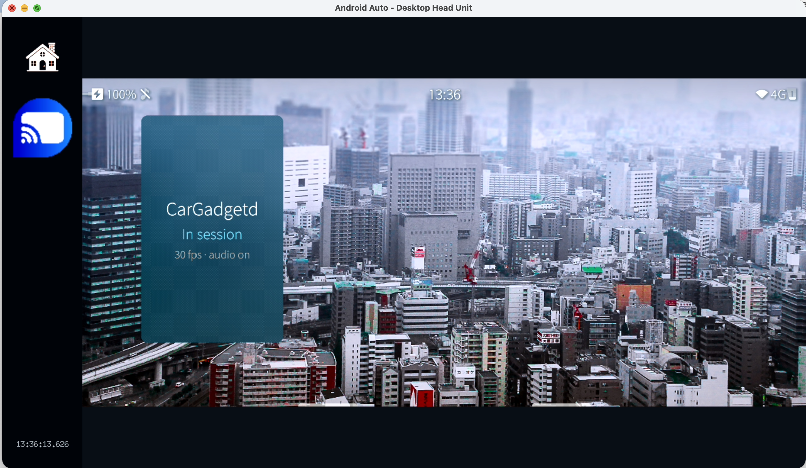

# Cargadgetd link

Phone screen mirror for cargadgetd. 

Contains two setuid root helpers `cargadgetd-linkcap` and `cargadgetd-linktouch`. Could be potentially used to escalate privilages.

## Screenshot




Shell visible above: [Basic](https://github.com/MrCyjaneK/cargadgetd_shell_basic)

```bash
sfosbuild 5.1.0.11 aarch64 ./rpm/cargadgetd-link.spec
```
